<div align="center">

# MagiChill

**Um RPG de turnos para jogar com calma.**

Monte um grupo de heróis, desça ao Cemitério Antigo e avance zona a zona até os Campos do Caos.
Sem cronômetro, sem pressa e sem perder o que já conquistou.

[](https://magichill.vercel.app/)


[**Jogar agora**](https://magichill.vercel.app/) · [Guia de testes beta](TESTES_BETA.md) · [Especificação](SPEC.md) · [Progresso](PROGRESSO.md)

<br>

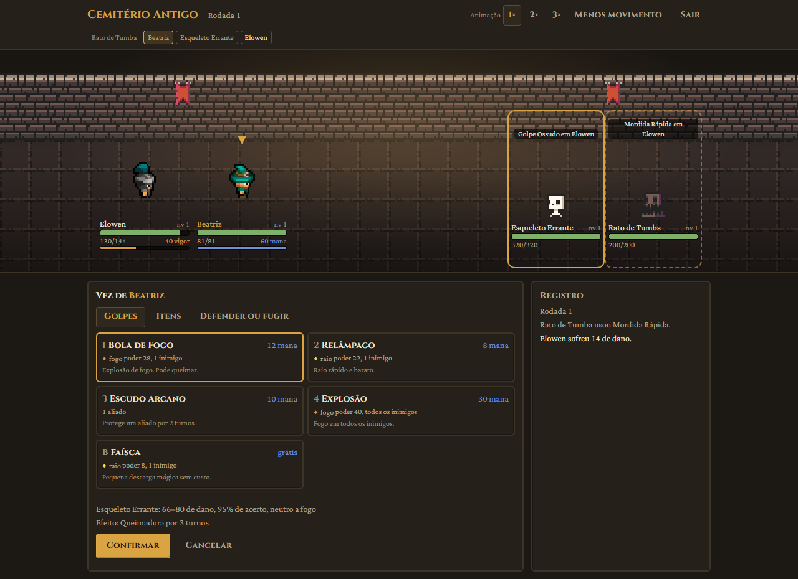

</div>

---

MagiChill é um RPG de turnos com tema medieval e fantasia, feito para sessões curtas e tranquilas.
Você forma um grupo de até 4 heróis, escolhe cada ação manualmente em batalhas de poucos turnos e,
fora do combate, deixa a reserva treinando, explorando ou cozinhando, mesmo com o jogo fechado.

A batalha espera por você para sempre: dá para pensar com calma, sair no meio e voltar depois no
mesmo turno. Perder também não pune: o grupo recua para a cidade com tudo o que já ganhou.

Roda inteiro no navegador, no computador ou no celular, sem instalação e sem conta.

## 🖼️ Imagens

<table>
  <tr>
    <td width="50%">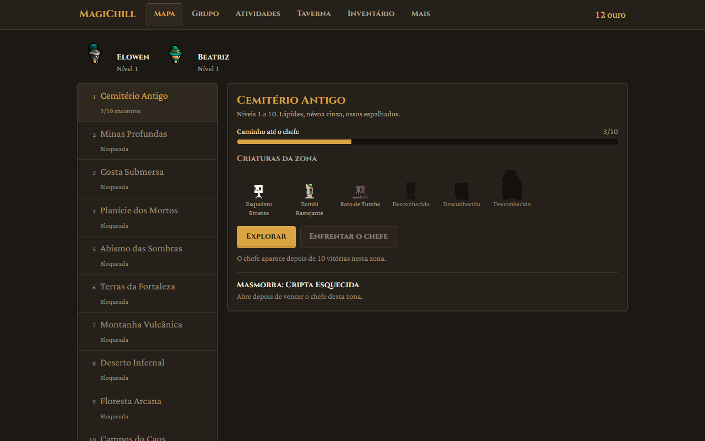</td>
    <td width="50%">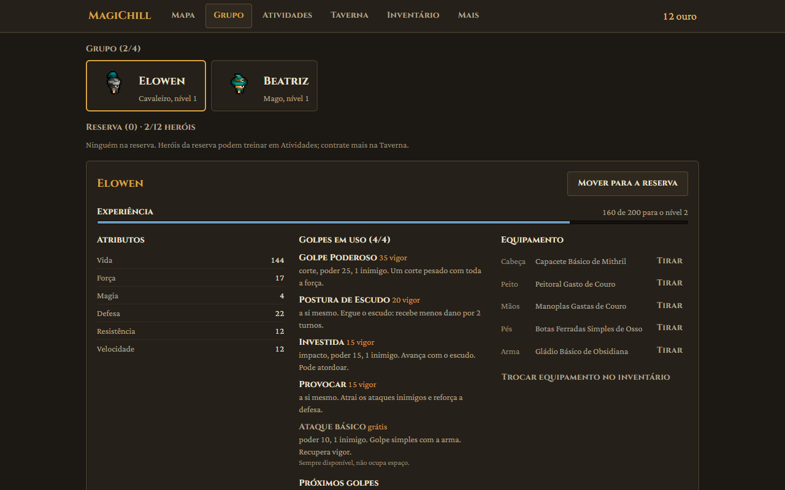</td>
  </tr>
  <tr>
    <td align="center"><sub><b>Mapa</b>: zonas, caminho até o chefe e criaturas da região</sub></td>
    <td align="center"><sub><b>Grupo</b>: atributos, golpes e equipamento de cada herói</sub></td>
  </tr>
  <tr>
    <td>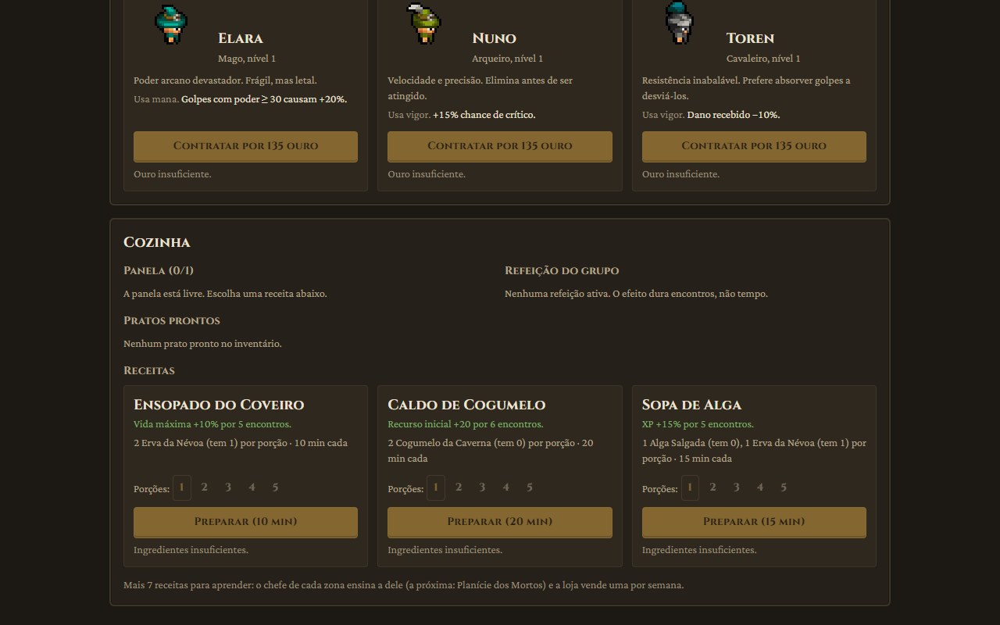</td>
    <td>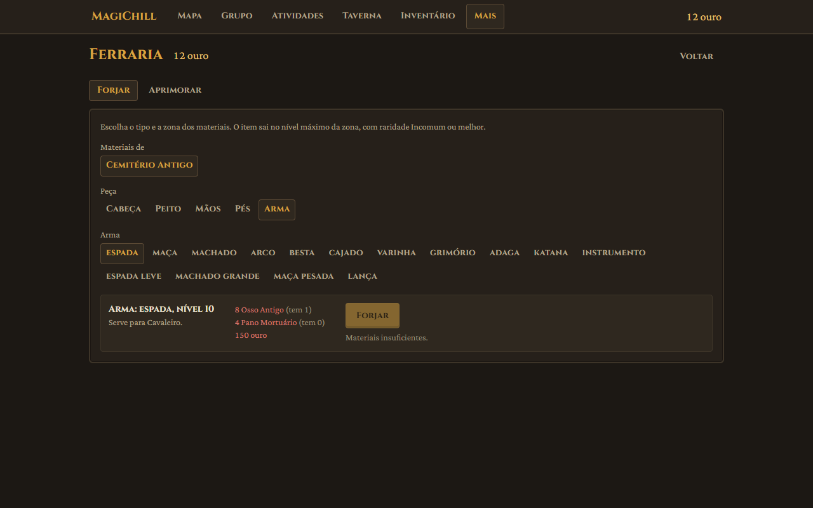</td>
  </tr>
  <tr>
    <td align="center"><sub><b>Taverna</b>: mural de recrutas e cozinha</sub></td>
    <td align="center"><sub><b>Ferraria</b>: forjar e aprimorar equipamentos</sub></td>
  </tr>
  <tr>
    <td>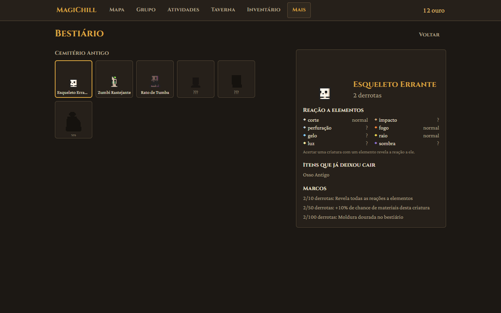</td>
    <td align="center">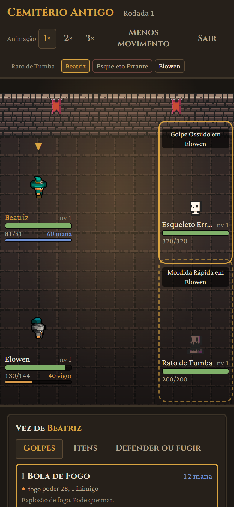</td>
  </tr>
  <tr>
    <td align="center"><sub><b>Bestiário</b>: fraquezas, drops e marcos</sub></td>
    <td align="center"><sub><b>No celular</b>: todas as telas se ajustam a telas pequenas</sub></td>
  </tr>
</table>

<details>
<summary><b>Os 4 temas de cor</b></summary>
<br>

<table>
  <tr>
    <td width="50%">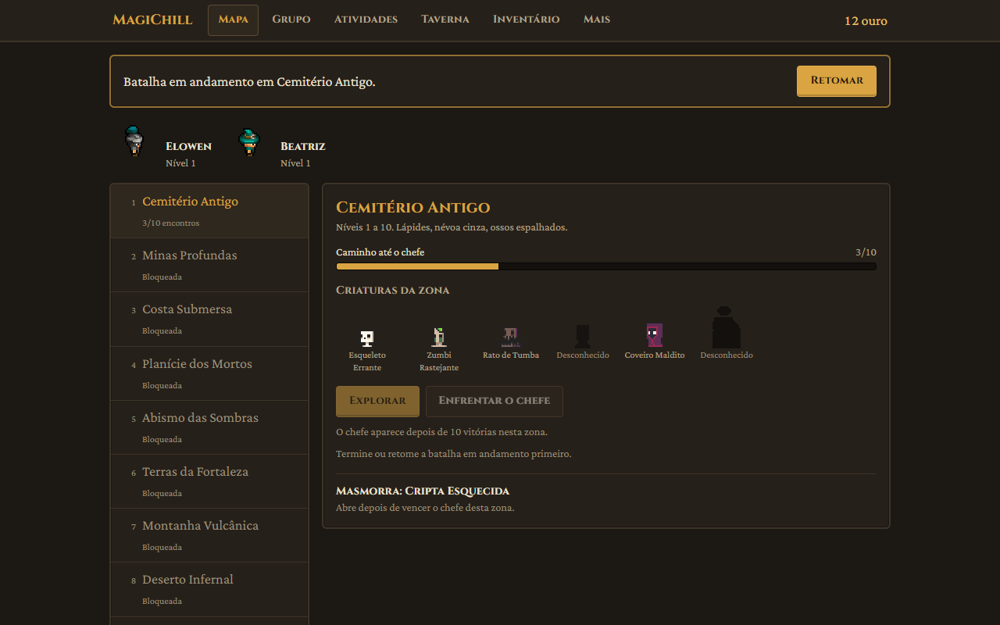</td>
    <td width="50%">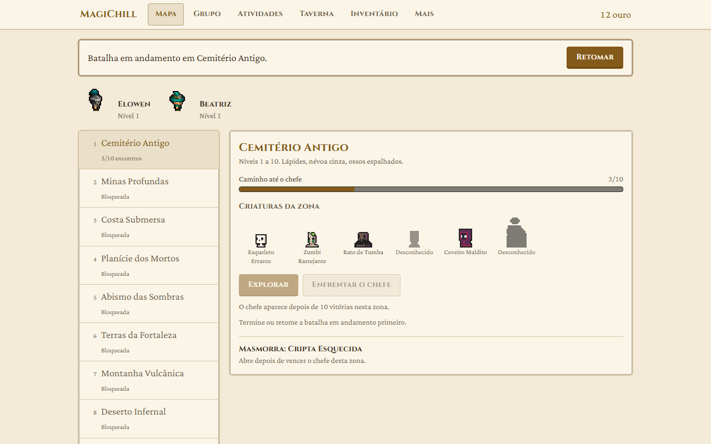</td>
  </tr>
  <tr>
    <td align="center"><sub>Taverna (padrão)</sub></td>
    <td align="center"><sub>Pergaminho (claro)</sub></td>
  </tr>
  <tr>
    <td>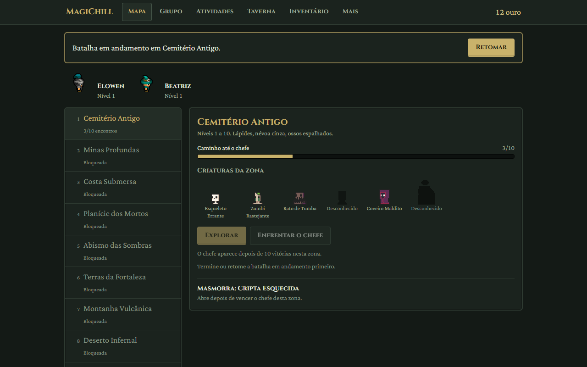</td>
    <td>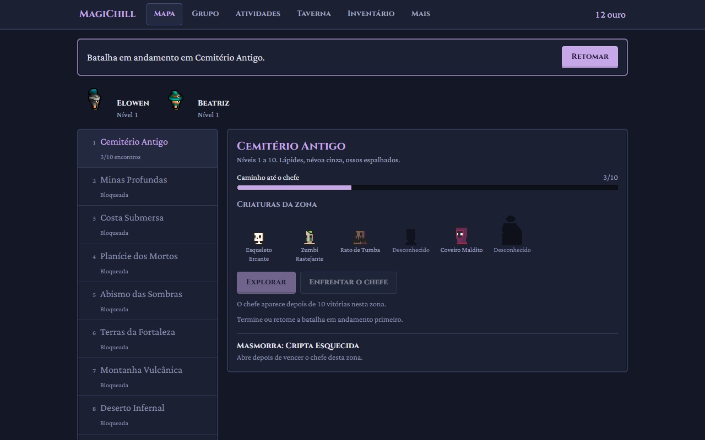</td>
  </tr>
  <tr>
    <td align="center"><sub>Bosque</sub></td>
    <td align="center"><sub>Noite</sub></td>
  </tr>
</table>

</details>

<sub>Capturas reais do jogo, tiradas no começo de uma jornada nova (heróis de nível 1).</sub>

## 📜 Sobre o jogo

### O ciclo de jogo

Uma sessão típica leva de 5 a 15 minutos:

1. **Coletar** o que a reserva trouxe de treinos, expedições e da panela.
2. **Comer** uma refeição na Taverna para ganhar um bônus nos próximos encontros.
3. **Explorar** uma zona e vencer de 3 a 6 encontros.
4. **Equipar** os drops, distribuir pontos e trocar golpes.
5. **Mandar** a reserva para novas atividades e sair. O tempo continua correndo a seu favor.

### Combate tático, sempre manual

- **Turnos por velocidade**, com a ordem da rodada atual e da próxima sempre visível.
- **Intenção dos inimigos à mostra:** cada inimigo avisa qual golpe vai usar e em quem. Chefes
  avisam um turno antes quando preparam um golpe forte.
- **Prévia antes de confirmar:** faixa de dano, chance de acerto e a reação do alvo ao elemento.
- **8 elementos** (corte, impacto, perfuração, fogo, gelo, raio, luz e sombra). As fraquezas
  começam ocultas e são descobertas ao acertar o elemento certo.
- **Mana ou vigor:** cada classe usa um recurso. O ataque básico e o Defender nunca custam nada.
- **Status** como Veneno, Queimadura, Lentidão e Atordoado, além de proteções e provocação.
- **Sem pressa:** nenhum cronômetro, animações em 1×, 2× ou 3× e a opção "Menos movimento".
- **Sem punição:** a derrota devolve o grupo à cidade mantendo todo o ouro, XP e itens já ganhos.

### Heróis e grupo

Seis classes, cada uma com recurso, passivo e 8 golpes: 4 iniciais e 4 avançados, aprendidos nos
níveis 8, 16, 30 e 45 (ou antes, com treino).

| Classe | Recurso | Passivo |
|---|---|---|
| Cavaleiro | vigor | Dano recebido −10% |
| Arqueiro | vigor | +15% de chance de crítico |
| Mago | mana | Golpes com poder ≥ 30 causam +20% |
| Assassino | vigor | Primeiro golpe de dano na batalha +30% |
| Bardo | mana | No fim do turno, 20% de chance de restaurar 8 de recurso a um aliado |
| Bárbaro | vigor | +3 de Força a cada 20% de vida perdida |

Você começa com um herói (escolhido entre 3 classes sorteadas) e um companheiro de outra classe.
Cada nível dá 3 pontos para distribuir entre Vida, Força, Magia, Defesa, Resistência e Velocidade.
O grupo leva até 4 heróis; os demais ficam na reserva, até 12 no total.

### Zonas, chefes e masmorras

**10 zonas** cobrem os níveis 1 a 100: Cemitério Antigo, Minas Profundas, Costa Submersa,
Planície dos Mortos, Abismo das Sombras, Terras da Fortaleza, Montanha Vulcânica, Deserto
Infernal, Floresta Arcana e Campos do Caos.

- Depois de 10 vitórias numa zona, o **chefe** aparece. Vencê-lo libera a próxima zona e a
  masmorra da região.
- Cada zona tem uma **masmorra** de 5 andares e um chefe no 6º. A vida não volta cheia entre os
  andares, e fogueiras depois do 2º e do 4º andar dão um respiro. O chefe da masmorra entrega um
  equipamento Lendário.
- Fechar o jogo no meio de uma batalha ou de uma descida não perde nada: basta retomar.

### Taverna, recrutas e cozinha

- **Mural de recrutas:** 3 heróis para contratar, renovados a cada 24 horas. Bardo, Assassino e
  Bárbaro chegam ao mural depois dos chefes das 3 primeiras zonas.
- **Cozinha:** 10 receitas (3 conhecidas desde o início, as outras ensinadas pelos chefes ou
  vendidas na loja). A panela trabalha em tempo real e prepara até 5 porções por vez.
- **Refeições** dão bônus ao grupo (vida máxima, ataque, defesa, recurso inicial, XP ou ouro) que
  duram alguns **encontros**, não horas. Nada expira enquanto você está fora.

### Atividades em tempo real

Heróis da reserva trabalham enquanto o jogo está fechado:

- **Treino:** ganha pontos de atributo (1, 2, 4 ou 8 horas) ou aprende um golpe avançado antes do
  nível.
- **Expedições:** viagens de 30 minutos a 8 horas para uma zona já liberada, trazendo ouro, XP,
  materiais e ingredientes. As vagas aumentam com o progresso, até 3.
- Ao voltar, o resumo **"Bem-vindo de volta"** mostra o tempo fora e o que ficou pronto.

### Equipamentos, loja e ferraria

- **5 espaços de equipamento** por herói (cabeça, peito, mãos, pés e arma) e **5 raridades**:
  Comum, Incomum, Raro, Épico e Lendário.
- **Loja:** 5 equipamentos que mudam todo dia, consumíveis sempre à venda e uma receita por semana.
- **Ferraria:** forje peças com os materiais de cada zona (raridade Incomum ou melhor) e aprimore
  de +1 a +5. O aprimoramento nunca falha.

### Relíquias, bestiário e coleção

- **10 relíquias**, uma por chefe de zona. Não ocupam espaço nem precisam ser equipadas: ter a
  relíquia já ativa o efeito para o grupo inteiro.
- **Bestiário:** cada criatura registra derrotas, reações a elementos e drops. Aos 10, 50 e 100
  derrotas há marcos que revelam afinidades, aumentam a chance de materiais e dão uma moldura
  dourada.
- **Coleção:** catálogo de equipamentos por tipo e raridade, itens e relíquias, com o percentual
  de conclusão.

### Temas, som e acessibilidade

- **4 temas de cor** (Taverna, Pergaminho, Bosque e Noite). Um teste automatizado confere o
  contraste de todas as cores de texto pela fórmula da WCAG (mínimo de 4,5:1).
- **Efeitos sonoros e música** da cidade e de batalha, com volumes separados.
- Navegação completa por **teclado**, foco visível e layout pensado para celular.

## 🧭 Como jogar

1. Abra [magichill.vercel.app](https://magichill.vercel.app/) e escolha **"Começar nova jornada"**
   em um dos 3 espaços de save.
2. Escolha a classe do herói e dê um nome. Um companheiro de outra classe vem junto.
3. No **Mapa**, selecione o **Cemitério Antigo** e toque em **Explorar**.
4. Na batalha, escolha um golpe e depois o alvo. Passe o mouse (ou toque) no alvo para ver a
   prévia antes de confirmar.
5. Depois de algumas lutas, explore as outras abas: **Grupo** (pontos e golpes), **Atividades**
   (treino e expedições), **Taverna** (recrutas e cozinha), **Inventário** e **Mais** (loja,
   ferraria, bestiário, coleção e configurações).

**Atalhos de teclado na batalha**

| Tecla | Ação |
|---|---|
| <kbd>1</kbd> a <kbd>4</kbd> | Escolher um golpe |
| <kbd>B</kbd> | Ataque básico |
| <kbd>D</kbd> | Defender |
| <kbd>←</kbd> <kbd>→</kbd> | Trocar o alvo |
| <kbd>Enter</kbd> | Confirmar |
| <kbd>Esc</kbd> | Cancelar |
| <kbd>Espaço</kbd> | Adiantar a animação |

> [!TIP]
> Fugir sempre funciona em encontros comuns, mas não contra chefes. Se a luta apertar, recue:
> nada do que você já ganhou se perde.

## 🛠️ Tecnologias

| Tecnologia | Papel no projeto |
|---|---|
| [React 18](https://react.dev/) | Interface, com estado global em `useReducer` + Context (sem biblioteca de estado) |
| [Vite 5](https://vitejs.dev/) | Servidor de desenvolvimento e build de produção |
| [Tailwind CSS 4](https://tailwindcss.com/) | Estilos e tokens de tema (`@theme`), via `@tailwindcss/vite` |
| [Vitest](https://vitest.dev/) | Testes do motor, dos dados, do save e simulações de balanceamento |
| [ESLint 9](https://eslint.org/) | Padronização do código, com regras de React e hooks |

Alguns princípios do projeto:

- **JavaScript + JSX**, 100% frontend: sem backend e sem serviços pagos.
- **Só React e React DOM em produção:** nenhuma biblioteca de animação, roteamento, datas ou
  números aleatórios. O gerador com semente (mulberry32) é do próprio projeto.
- **Motor de jogo em JS puro** (`src/engine/`), sem React e sem `localStorage`. Ele recebe o
  relógio e o gerador aleatório por parâmetro, então os testes são determinísticos e recarregar a
  página no meio de uma batalha não muda o resultado.
- **A interface só anima:** o motor resolve o turno inteiro e devolve uma lista de eventos; a tela
  os reproduz em sequência e bloqueia ações durante a animação.

## 💻 Executando localmente

**Requisitos:** [Node.js](https://nodejs.org/) 18 ou mais recente (exigido pelo Vite 5) e npm.

```bash
# clonar o repositório
git clone https://github.com/joaofsdev/rpg.git
cd rpg

# instalar as dependências
npm install

# servidor de desenvolvimento (http://localhost:5173)
npm run dev
```

Outros comandos disponíveis:

```bash
npm test             # roda todos os testes uma vez (Vitest)
npm run test:watch   # testes em modo observação
npm run lint         # ESLint (deve passar sem erros nem avisos)
npm run build        # build de produção em dist/
npm run preview      # serve o build de dist/ localmente
```

> [!NOTE]
> A suíte inclui simulações de balanceamento de combate, economia e masmorras, então `npm test`
> leva cerca de 20 segundos.
>
> Se o Vite reclamar do binário do esbuild, rode `npm install-scripts approve esbuild` e depois
> `npm install` de novo.

## 🗂️ Estrutura do projeto

```text
rpg/
├── docs/capturas/        capturas de tela usadas neste README
├── public/               arquivos servidos como estão (ícone da página)
├── src/
│   ├── engine/           motor de jogo em JS puro: combate, IA, progressão, itens,
│   │                     atividades por tempo; testes *.test.js ao lado de cada módulo
│   ├── data/             conteúdo do jogo: classes, golpes, inimigos, zonas, itens,
│   │                     receitas, relíquias, temas e constantes
│   ├── state/            store global (reducer + Context), ações e seletores
│   ├── save/             slots, versão do save, migrações, exportar/importar e
│   │                     adaptador do localStorage
│   ├── components/
│   │   ├── screens/      uma tela por arquivo (Mapa, Batalha, Grupo, Taverna…)
│   │   ├── battle/       peças da batalha: sprites, menu de ações, prévia, ordem de turnos
│   │   ├── taverna/      cozinha
│   │   └── common/       botões, modais, barras, navegação, som e trilha sonora
│   ├── assets/
│   │   ├── sprites/      heróis, criaturas, cenário e itens (PNG)
│   │   └── audio/        efeitos sonoros e músicas
│   ├── App.jsx
│   ├── main.jsx
│   └── index.css         tokens de tema (@theme) e animações globais
├── SPEC.md               especificação completa do design (fonte da verdade)
├── PROGRESSO.md          fases concluídas, decisões e pendências
├── TESTES_BETA.md        guia para quem vai testar a versão beta
├── CREDITS.md            origem e licença de cada asset
└── vercel.json           configuração de deploy na Vercel
```

O fluxo é sempre em uma direção: os **componentes** leem o estado e disparam ações; o **state**
chama o **motor** e entrega o resultado ao **save**, que é o único lugar que toca o `localStorage`.

## 💾 Salvamento e progresso

- O progresso é salvo **automaticamente**, a cada ação, no `localStorage` do navegador.
- Há **3 espaços de save** independentes.
- **O save pertence ao navegador e ao aparelho.** Não há conta nem sincronização: jogar no celular e
  no computador são dois jogos separados.
- Limpar os dados do site, usar uma janela anônima ou deixar o navegador liberar espaço apaga o
  progresso. No Safari, ficar 7 dias sem abrir o site também pode apagar.
- **Para guardar uma cópia**, use **"Exportar"** na tela inicial: o jogo baixa um arquivo `.json`
  que pode ser trazido de volta com **"Importar save de um arquivo"**, inclusive em outro aparelho.
- Quando o jogo é atualizado, saves antigos são **migrados automaticamente** para o formato novo.

## 🚧 Estado do projeto

As **11 fases do roadmap** estão concluídas: motor, combate, as 10 zonas, masmorras, recrutamento
e treino, expedições, cozinha, ferraria, relíquias, coleção, temas e áudio. O jogo dá para ser
jogado do começo ao fim e está em **testes beta** na Vercel.

Por ser beta, o **balanceamento ainda vai mudar**, em especial os custos de recrutas, treino e
ferraria e o ganho do aprimoramento. Alguns inimigos também usam artes aproximadas ou a mesma
figura com outra cor.

A lista completa de decisões, pendências e melhorias futuras fica no [PROGRESSO.md](PROGRESSO.md),
e os problemas conhecidos para testadores, no [TESTES_BETA.md](TESTES_BETA.md).

## 🙏 Créditos e licenças

Todos os sprites e sons vêm de pacotes gratuitos com licença **CC0 (domínio público)**, e as fontes
usam a **SIL Open Font License**:

- Heróis: *Puny Characters*, de Shade (OpenGameArt)
- Criaturas, cenário e itens: *16x16 DungeonTileset II*, de 0x72 (itch.io)
- Efeitos sonoros: *RPG Audio* e *Interface Sounds*, de Kenney
- Músicas: *Medieval: The Old Tower Inn* e *Medieval: Battle*, de RandomMind (OpenGameArt)
- Fontes: *Cinzel*, de Natanael Gama, e *Crimson Pro*, de Jacques Le Bailly (Google Fonts)

Os links, os arquivos de origem e o mapeamento de cada asset estão no [CREDITS.md](CREDITS.md).

O ritmo e a progressão foram inspirados no [PokeChill](https://play-pokechill.github.io/), mas
nenhum código, texto, nome ou asset dele é usado neste projeto.

O repositório ainda não tem um arquivo de licença para o código-fonte.
